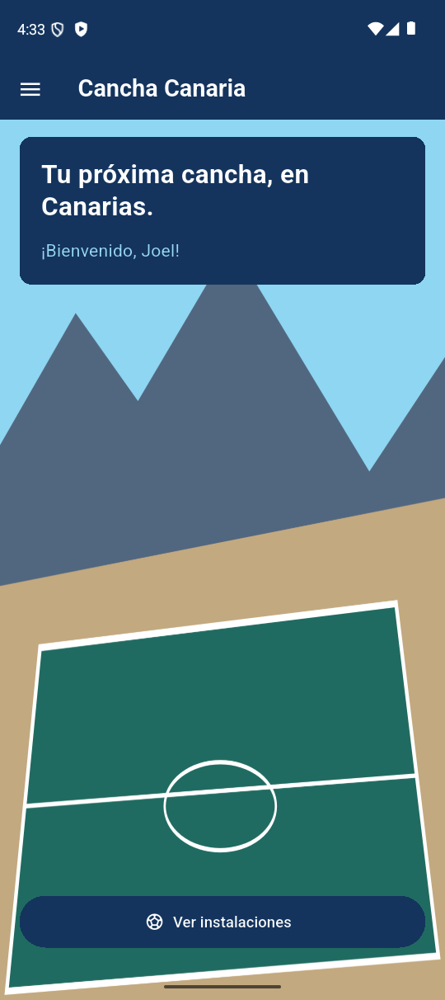
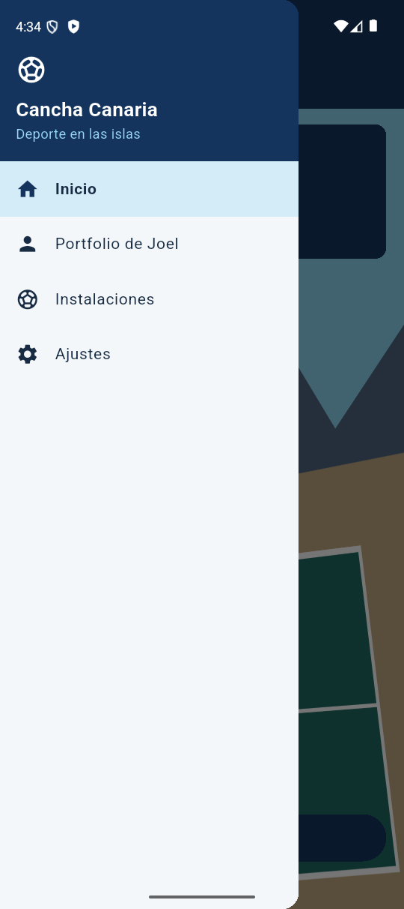
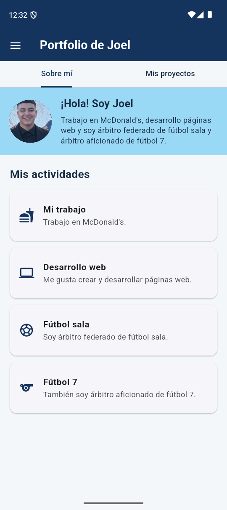
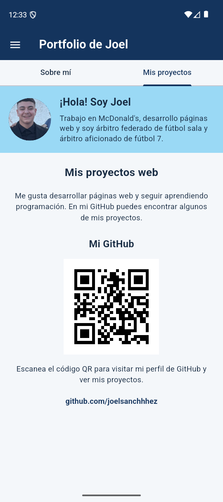
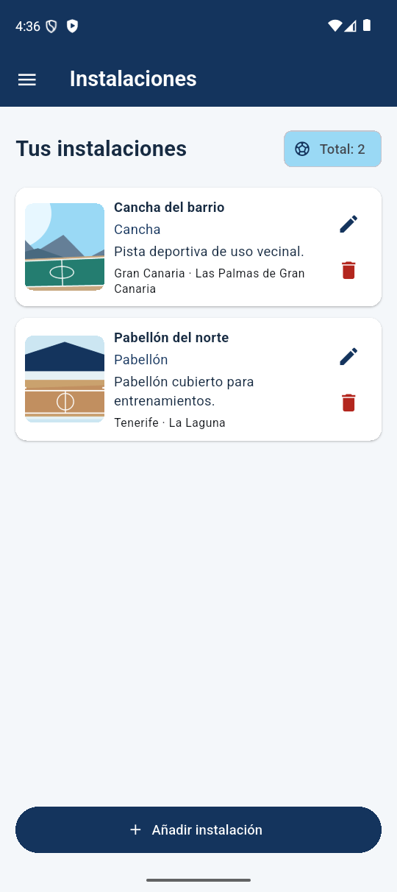
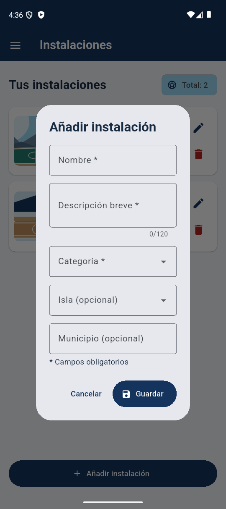
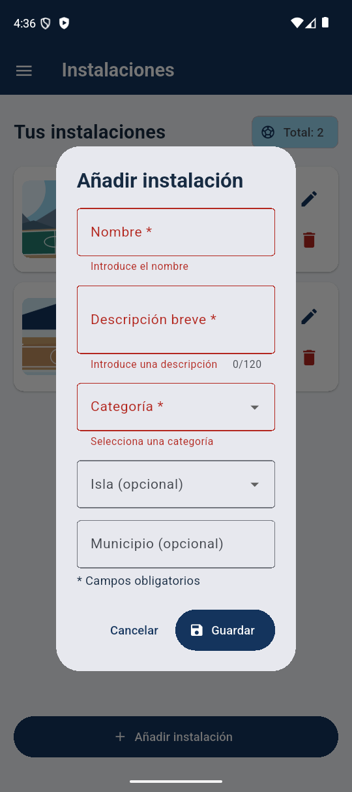
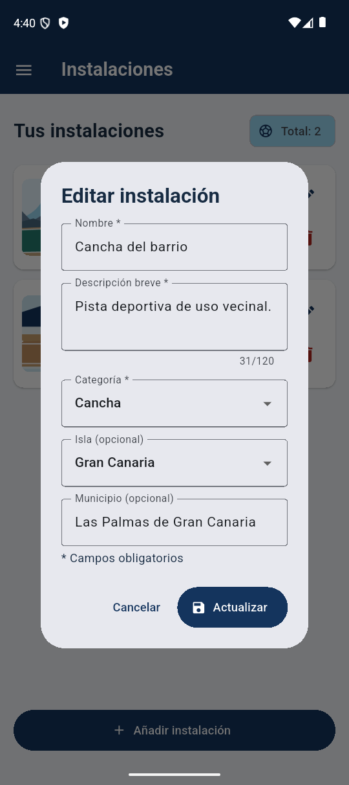
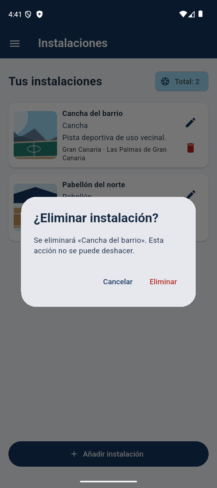

# Cancha Canaria — PGL-P2-MyPortfolio

**UD2 / Práctica 2 · Tarea 3: Formulario de instalaciones**

Joel Sánchez Siliuto · 2.º DAM · Salesianos La Cuesta

## Qué hace la aplicación

Cancha Canaria muestra una bienvenida y permite acceder desde un Drawer al
portfolio de Joel, a Instalaciones y a Ajustes. El portfolio tiene las pestañas
Sobre mí y Mis proyectos, con fotografía, actividades y QR del perfil de GitHub.
Instalaciones permite crear, editar y eliminar registros; Ajustes queda reservado.

## Navegación con go_router

`MaterialApp.router` y `ShellRoute` comparten el AppBar y el Drawer.
Se mantienen los destinos y callbacks de la versión actual, la selección activa
y el cierre del menú. A petición de esta tarea se recupera `go_router`, ya que
la última entrega había cambiado a `Navigator` con rutas nombradas.

| Ruta | Pantalla |
| --- | --- |
| `/` | Bienvenida |
| `/portfolio` | Portfolio con dos pestañas |
| `/instalaciones` | Lista dinámica y formulario |
| `/ajustes` | Aviso de próxima tarea |

## Tarea 3: gestión de instalaciones

- Lista dinámica con `ListView.builder`, `StatefulWidget` y `setState`.
- Alta en formulario modal con nombre, descripción de hasta 120 caracteres y
  categoría obligatorios. Los espacios vacíos no son válidos.
- Isla y municipio opcionales.
- Categorías Cancha, Pabellón y Campo de fútbol, con imágenes locales distintas.
- Edición en el mismo formulario con todos los datos precargados.
- Eliminación individual con confirmación y posibilidad de cancelar.
- Contador actualizado al crear o eliminar y mensaje para la lista vacía.

Los dos registros iniciales son ejemplos. Los datos se conservan al cambiar
entre destinos durante la sesión y se reinician al cerrar la aplicación;
no se utiliza base de datos. «Borrar todos» permite vaciar la lista con un
diálogo de confirmación; se desactiva cuando no hay instalaciones.

La integración parte del commit `2b7bd42` del repositorio actual y añade solo
el modelo, el formulario, las tarjetas y las imágenes de categorías del ZIP.
Conserva la fotografía, la imagen de cancha, el tema, las actividades, el QR,
el enlace a GitHub y las pestañas del portfolio de la entrega más reciente.

## Portfolio y diseño

Las pestañas usan `DefaultTabController`, `TabBar` y `TabBarView`. Son widgets
estándar para implementar las dos secciones del diseño, aunque su implementación
no se desarrolla en los apuntes aportados. Las tarjetas, la presentación y los
proyectos se separan en widgets pequeños y comentados.

Se conservan los colores: primario `#14345D`, secundario `#9AD9F5`, fondo
`#F4F7FA` y texto `#172B42`. La fotografía está en `assets/images/joel.jpg`.
La cancha del código inicial se ha exportado como `assets/images/cancha.png`:
la bienvenida utiliza `Image.asset`, sin código para dibujar con un lienzo.

`qr_flutter` y `url_launcher` conservan el QR y el enlace del portfolio inicial.

## Ejecutar y compilar

```bash
flutter pub get
flutter run
```

Para ejecutar en navegador:

```bash
flutter run -d chrome
```

Para analizar y compilar:

```bash
flutter analyze
flutter test
flutter build apk --debug
flutter build web
```

El APK se genera en `build/app/outputs/flutter-apk/app-debug.apk`.
El identificador Dart es `pgl_p2_myportfolio`, porque el nombre del paquete
no admite mayúsculas ni guiones.

## Estructura

```text
lib/
  main.dart                  # MaterialApp.router, tema y AppRouter
  app_router.dart            # ShellRoute, Scaffold común y go_router
  tema.dart                  # Colores y tema
  pantallas/
    inicio.dart              # Imagen y bienvenida
    portfolio.dart           # Sobre mí y Mis proyectos
    instalaciones.dart       # Lista dinámica y CRUD
    ajustes.dart             # Reservada para otra tarea
  widgets/
    menu_lateral.dart        # Opciones del Drawer y callback
    presentacion.dart        # Fotografía y presentación
    actividades.dart         # Tarjetas de actividades
    proyectos.dart           # QR y enlace a GitHub
assets/images/
  joel.jpg
  cancha.png
```

## Comprobación manual

- Abrir el Drawer y comprobar las cuatro opciones y la selección activa.
- Entrar en cada destino y comprobar el título y el cierre del menú.
- Pulsar otra vez el destino activo y comprobar que el Drawer se cierra.
- Volver a Inicio y pulsar Ver instalaciones.
- Abrir el portfolio y alternar Sobre mí y Mis proyectos, también deslizando.
- Comprobar la fotografía, las actividades, el QR y el enlace de GitHub.

Las pruebas de widgets cubren navegación, apertura del formulario, validación,
alta con categoría e imagen, edición precargada, conservación al navegar,
cancelación y confirmación de eliminación, lista vacía y cancelación de alta.

Verificado en esta entrega: `flutter analyze` sin incidencias y
`flutter test` con las tres pruebas superadas. La app se ha compilado y
ejecutado en Android Pixel 9.

## Capturas reales

Capturas reales de esta versión ejecutada en el emulador Android Pixel 9
(540 × 1212, densidad 210). Se conservan las capturas del portfolio de la
entrega anterior, cuyo código y recursos no cambian.











## Repositorio y entrega

[Repositorio público](https://github.com/joelsanchhhez/PGL-P2-MyPortfolio)

Rama local de trabajo: `P2-Tarea3-Formulario`. Parte de la rama existente
`P2-Tarea1-Navegación`. No se ha publicado esta rama en GitHub.

```bash
git switch P2-Tarea3-Formulario
flutter pub get
flutter analyze
flutter test
flutter run
```
