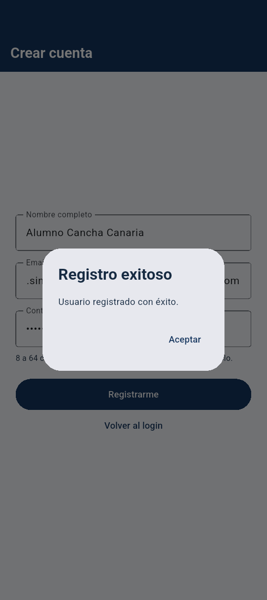
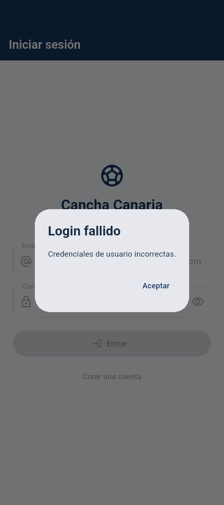
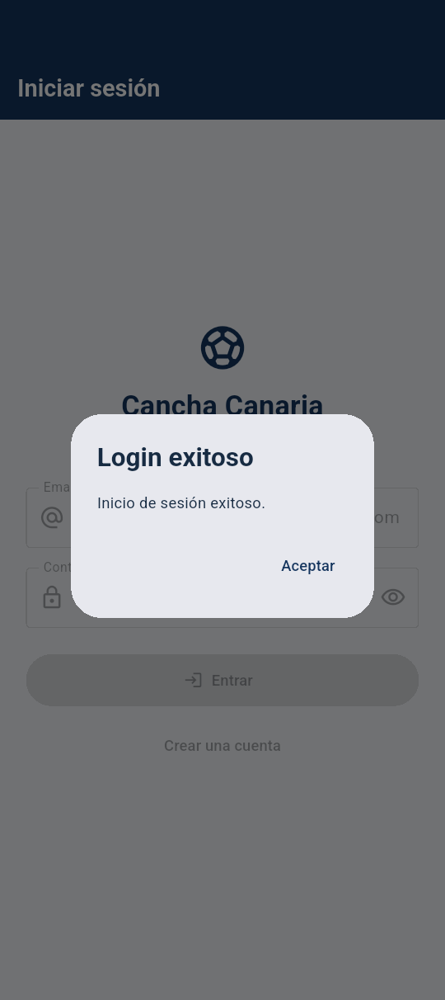
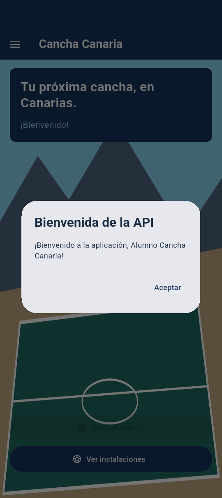

# Cancha Canaria — P2 · Tarea 5: Sesión de usuario

Joel Sánchez Siliuto · 2.º DAM · Programación Multimedia y Dispositivos Móviles.

**[Rama de entrega: P2-Tarea5-SesionUsuario](https://github.com/joelsanchhhez/PGL-P2-MyPortfolio/tree/P2-Tarea5-SesionUsuario)**

La tarea añade registro e inicio de sesión a Cancha Canaria, manteniendo el diseño,
el portfolio, la navegación y el CRUD de Instalaciones de las tareas anteriores.
La implementación usa los conceptos de los apuntes: formularios con `Form` y
`TextEditingController`, callbacks, `StatefulWidget`, `setState`, `async/await`,
servicios HTTP, JSON, `factory fromJson`, un Singleton y excepciones propias.

## Funcionalidad de la práctica

- **Registro:** nombre completo, email y contraseña. Se validan los campos,
  se envían a la API y se muestra su respuesta en una alerta. Si el registro
  es correcto, al aceptar la alerta se vuelve al login.
- **Login:** email, contraseña, botón para registrarse y botón para enviar
  la petición. Tanto el éxito como los errores se muestran mediante alertas.
- **Token seguro:** tras un login correcto se guarda el JWT con
  `flutter_secure_storage`. Nunca se almacena la contraseña.
- **Inicio de la app:** solo aparece el login, sin Drawer. Se lee el token
  guardado y se comprueba en la API; si es válido, se abre Bienvenida.
- **Cerrar sesión:** el botón del Drawer elimina el JWT del dispositivo y
  vuelve al login. Las rutas privadas quedan bloqueadas sin sesión.
- **Bienvenida:** el botón «Mensaje de bienvenida» consulta el endpoint
  protegido y muestra el mensaje recibido de la API en una alerta.

El email debe tener un formato válido. En registro se exige nombre de 3 a 100
caracteres y contraseña de 8 a 64 caracteres con mayúscula, minúscula, número
y símbolo. En login se exige una contraseña no vacía para admitir cuentas previas.

## Servicios y almacenamiento

`ApiSesion` contiene todas las peticiones HTTP, la conversión de JSON y los
controles de respuesta. Las pantallas solo validan el formulario, llaman al
servicio, actualizan su estado y muestran la alerta correspondiente.

`ServicioSesion` es un Singleton sencillo, como el ejemplo de los apuntes.
Comparte el JWT en memoria y utiliza `flutter_secure_storage` para leerlo,
guardarlo y borrarlo de forma segura. En Android las claves están protegidas
por Android Keystore. Se desactiva la copia de seguridad automática para evitar
restaurar el token cifrado sin sus claves.

El token se envía como `Authorization: Bearer <token>`. La validez se consulta
en la API: no basta con leer el token del dispositivo. Si es rechazado se borra;
si falla la conexión se permanece en login sin destruir el token guardado.

## API del profesor

[Servicio](https://my-users-api.onrender.com) ·
[Repositorio y documentación](https://github.com/adhernea/my-users-api)

| Método | Endpoint | Datos |
| --- | --- | --- |
| POST | `/users/register` | `fullName`, `email`, `pwd` |
| POST | `/users/login` | `email`, `pwd`; devuelve `token` |
| GET | `/users/check-token` | Cabecera Bearer |
| GET | `/users/welcome` | Cabecera Bearer |

Render puede tardar 50–60 segundos en despertar. Se utiliza un timeout de
90 segundos y se desactivan los botones durante la petición. Los errores HTTP,
de conexión o de formato de respuesta también se muestran en alertas.
La persistencia de usuarios depende del servidor: SQLite puede perder sus datos
si Render reinicia el contenedor con almacenamiento efímero.

## Capturas reales

Capturas de esta versión simplificada ejecutándose en Android Pixel 9, contra
la API real del profesor, con una cuenta ficticia y la contraseña oculta.

### Registro exitoso



### Login fallido



### Login exitoso



### Respuesta del endpoint de bienvenida



## Ejecutar y comprobar

```bash
git clone --branch P2-Tarea5-SesionUsuario https://github.com/joelsanchhhez/PGL-P2-MyPortfolio.git
cd PGL-P2-MyPortfolio
flutter pub get
flutter run
```

```bash
flutter analyze
flutter test
```

Verificado el 19 de noviembre de 2026: `flutter analyze` sin incidencias y
`flutter test` con 6 pruebas superadas.

Se comprueban las validaciones, el modelo de respuesta, el login inicial sin
Drawer, la protección de rutas y las funciones previas del portfolio y el CRUD.
Además se ha verificado en el emulador el registro, ambos resultados de login,
la bienvenida, la restauración del token, el cierre de sesión y el rechazo de
un token inválido contra la API real.

## Archivos principales

```text
lib/
  main.dart                       # Arranque y tema
  app_router.dart                 # Rutas, Drawer y cierre de sesión
  pantallas/
    login.dart                    # Formulario y comprobación de sesión inicial
    registro.dart                 # Formulario de registro
    inicio.dart                   # Bienvenida y botón de la API
    portfolio.dart                # Portfolio anterior
    instalaciones.dart            # CRUD anterior
    ajustes.dart                  # Destino reservado anterior
  servicios/
    api_sesion.dart               # Peticiones HTTP y JSON
    servicio_sesion.dart          # Singleton y almacenamiento seguro del JWT
  modelos/respuesta_login.dart    # factory fromJson
  excepciones/error_api.dart      # Error con mensaje y código HTTP
  utilidades/validaciones_sesion.dart
  widgets/alerta_sesion.dart       # Alerta reutilizada
```
