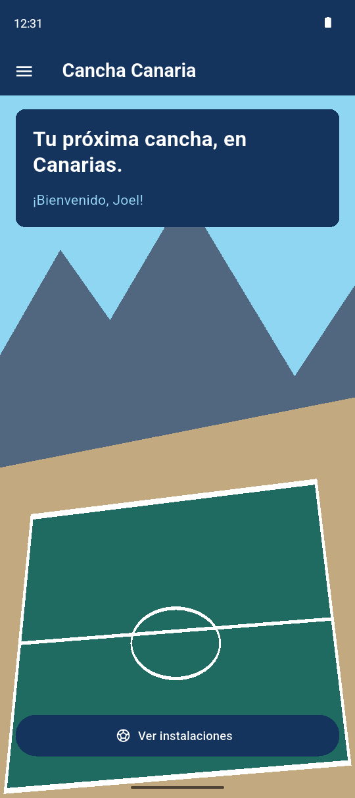
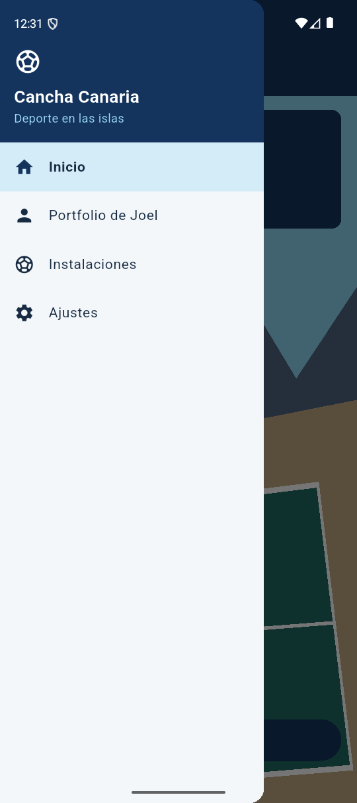
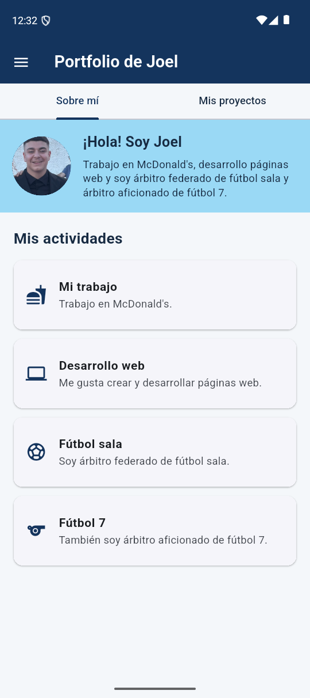
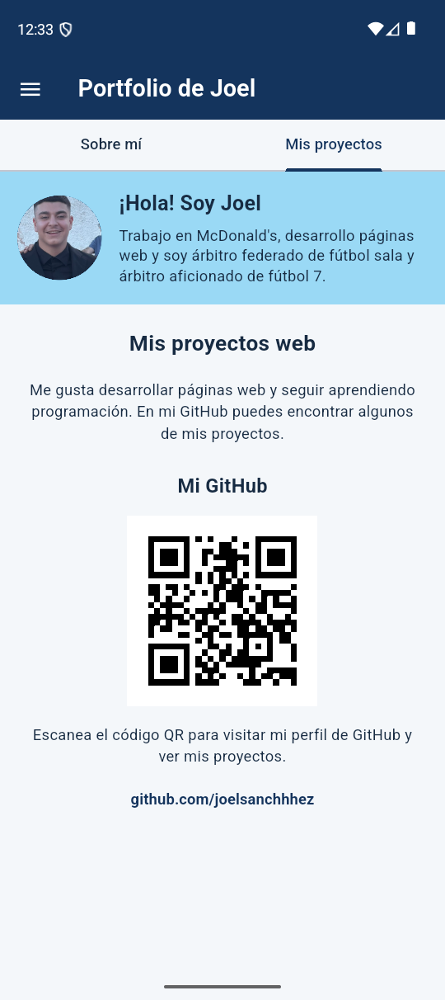

# Cancha Canaria — PGL-P2-MyPortfolio

**UD2 / Práctica 2 · Tarea 1: Navegación**  
Alumno: Joel Sánchez Siliuto · 2.º DAM · Salesianos La Cuesta

## Descripción

Aplicación Flutter de instalaciones deportivas de Canarias. Esta primera tarea
de implementación reproduce el diseño de la práctica 1 e incorpora la
**bienvenida**, la navegación lateral con **Drawer + go_router** y el
**portfolio de Joel** con pestañas. Las secciones Instalaciones y Ajustes se
muestran como futuras ampliaciones; no se ha implementado aún el CRUD ni las
preferencias persistentes.

## Implementado

- **Inicio** (`/`): ilustración de cancha, presentación y botón «Ver instalaciones».
- **Drawer**: cabecera azul, menú Inicio / Portfolio / Instalaciones / Ajustes,
  con opción activa destacada.
- **Portfolio** (`/portfolio`): `DefaultTabController` + `TabBar` + `TabBarView`;
  datos biográficos, tarjetas de actividades y QR de GitHub.
- **go_router**: rutas declaradas en `app_router.dart` con `ShellRoute` para
  conservar el mismo `Scaffold`, `AppBar` y `Drawer` en todas las pantallas.
- **Tema**: primario `#14345D`, secundario `#9AD9F5`, fondo `#F4F7FA`, texto
  `#172B42`.

## Preparación y ejecución

El proyecto incluye las plataformas Android y web. Desde esta carpeta:

```bash
flutter pub get
flutter run
# Alternativa para ejecutar en navegador:
flutter run -d chrome
```

> `PGL-P2-MyPortfolio` es el nombre del repositorio y la carpeta de entrega.
> `pgl_p2_myportfolio` es el identificador válido del paquete Dart: no puede
> llevar guiones ni mayúsculas.

### Comprobaciones

```bash
flutter analyze
flutter test
flutter build apk --debug
flutter build web
```

## Estructura

```text
lib/
  main.dart                    # MaterialApp.router
  tema.dart                    # Paleta de la práctica 1
  app_router.dart              # ShellRoute y destinos
  pantallas/
    inicio.dart                # Bienvenida
    portfolio.dart             # Pestañas
    instalaciones.dart         # Próxima tarea (marcador)
    ajustes.dart               # Próxima tarea (marcador)
  widgets/
    menu_lateral.dart          # Drawer reutilizable
    cancha_fondo.dart          # Ilustración de cancha
    presentacion.dart          # Presentación de Joel
    actividades.dart           # Tarjetas de actividades
    proyectos.dart             # QR y enlace al GitHub
```

## Capturas de pantalla

Capturas reales de esta versión ejecutada en el emulador Android Pixel 9.
Se ha usado una resolución de 540 × 1212 y densidad 210 para reducir la carga
gráfica del emulador, manteniendo la misma escala de la interfaz.






## Publicación en GitHub

La rama local `P2-Tarea1-Navegación` ya está creada. Crea un **repositorio vacío** en el perfil `joelsanchhhez` con el nombre
`PGL-P2-MyPortfolio`. Después, desde el proyecto:

```bash
git remote add origin https://github.com/joelsanchhhez/PGL-P2-MyPortfolio.git
git push -u origin 'P2-Tarea1-Navegación'
```

**Entregable:** una vez creada y subida la rama, copia su enlace desde la web
de GitHub. No se incluye un enlace a una rama inexistente.

## Recursos visuales

La fotografía de Joel se ha convertido de HEIC a JPEG y se incluye en
`assets/images/joel.jpg`. `Presentacion` la muestra con `CircleAvatar` en ambas
pestañas. La cancha conserva la ilustración vectorial del código inicial.

## Referencia del diseño

`Cancha_Canaria_Diseno_Joel.pdf` — páginas 2 (bienvenida), 3 (portfolio),
7 (organización), 8 (colores) y 9 (iconos), según la numeración impresa.

## Revisión del código inicial

El ZIP ya contenía las rutas con `go_router`, el menú, las pestañas, las tarjetas,
la ilustración y el QR. Se conservan estos widgets y su organización sencilla.
Se han generado Android y web, establecido el nombre visible de la aplicación y
corregido la cabecera del Drawer: ahora tiene altura mínima y crece si el texto
necesita más espacio, en vez de desbordarse con una altura fija.

La prueba de widgets comprueba el botón de bienvenida, las cuatro rutas,
el cierre del Drawer, pulsar la opción activa y el cambio entre ambas pestañas.
Las capturas documentan la aplicación ejecutada; no proceden del PDF.

El fondo conserva el dibujo con `CustomPainter` del código inicial.

## Validación de la entrega

- `flutter analyze`: sin problemas detectados.
- `flutter test`: prueba de navegación completa superada.
- `flutter build apk --debug`: APK Android compilado.
- `flutter build web`: compilación web comprobada.
- Revisión manual y capturas en el emulador Pixel 9.

Para instalar el APK tras compilar, usa `flutter install --debug` con el
emulador encendido. El archivo generado está en
`build/app/outputs/flutter-apk/app-debug.apk`.
